# Отчёт по практической работе №4

**Тема:** Имитация спринта с использованием веток GitHub.

**Выполнил:** Малинин Константин Николаевич.\
**Группа:** М-25 ИО.\
**Дата основной работы:** 29.09.2026.\
**Дата дополнения и повторной проверки:** 16.11.2026.\
**Номер работы:** 4.

## 1. Цель работы и формат выполнения

Цель работы — пройти цикл учебного Scrum-спринта: определить цель и критерии готовности, разработать функции в отдельных ветках, оформить Pull Request, проверить изменения, разрешить конфликт, выполнить интеграцию и зафиксировать результаты спринта.

Выбран проект «Менеджер задач». Работа выполнена индивидуально. Все роли и функции выполняет один участник. Комментарии в PR являются самопроверкой, а не независимым ревью. Требование задания о команде из 4–5 человек и ревью от разных участников в таком формате не выполнено. По выбранному индивидуальному формату независимое ревью и связанные с ним действия пропущены. Согласование такого формата с преподавателем в материалах не подтверждено.

## 2. Репозиторий, роли и распределение функций

Публичный репозиторий: <https://github.com/konstmalinin-maker/sprint-demo>.

| Роль | Участник | Задачи |
| --- | --- | --- |
| Product Owner | Малинин Константин Николаевич | Цель спринта, User Stories, самостоятельная приёмка |
| Scrum Master | Малинин Константин Николаевич | Организация работы, контроль веток, ретроспектива |
| Developer | Малинин Константин Николаевич | Реализация, тестирование, самопроверка и интеграция всех функций |

| Feature-ветка | User Story | Issue | PR в sprint-1 |
| --- | --- | --- | --- |
| feature/user-auth | Как пользователь, хочу зарегистрироваться и войти в систему | [#1](https://github.com/konstmalinin-maker/sprint-demo/issues/1) | [#2](https://github.com/konstmalinin-maker/sprint-demo/pull/2) |
| feature/task-list | Как пользователь, хочу просматривать список задач | [#4](https://github.com/konstmalinin-maker/sprint-demo/issues/4) | [#5](https://github.com/konstmalinin-maker/sprint-demo/pull/5) |
| feature/task-create | Как пользователь, хочу создавать задачи с названием | [#6](https://github.com/konstmalinin-maker/sprint-demo/issues/6) | [#7](https://github.com/konstmalinin-maker/sprint-demo/pull/7) |
| feature/task-filter | Как пользователь, хочу выбирать выполненные и невыполненные задачи | [#8](https://github.com/konstmalinin-maker/sprint-demo/issues/8) | [#10](https://github.com/konstmalinin-maker/sprint-demo/pull/10) |
| feature/task-stats | Как пользователь, хочу видеть количество задач по статусам | [#9](https://github.com/konstmalinin-maker/sprint-demo/issues/9) | [#11](https://github.com/konstmalinin-maker/sprint-demo/pull/11) |

Все пять PR объединены с `sprint-1`. В описаниях PR указаны связанные Issues через `Closes #N`. Автоматическое закрытие Issue зависит от попадания соответствующего PR в основную ветку.

## 3. Sprint Goal и Definition of Done

**Sprint Goal:** создать базовую функциональность менеджера задач: регистрацию и вход, создание и просмотр задач, фильтрацию по статусу и статистику.

Для индивидуального выполнения использованы следующие критерии готовности:

- Код написан и запускается локально.
- Для каждой функции есть хотя бы один юнит-тест.
- Выполнена самостоятельная проверка кода с фиксацией замечаний и ответов в PR.
- Feature-PR объединён с `sprint-1`.
- Документация обновлена при необходимости.

После настройки CI дополнительно проверяются Ruff и общий запуск тестов с измерением покрытия. В командном формате самопроверку необходимо дополнить независимым ревью минимум одного коллеги.

Цель и критерии сохранены в [docs/sprint-1-goal.md](https://github.com/konstmalinin-maker/sprint-demo/blob/main/docs/sprint-1-goal.md).

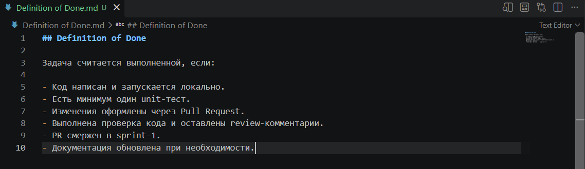

Рисунок 1. Критерии Definition of Done в исходных материалах.

## 4. Подготовка репозитория и разработка

Созданы `main`, ветка спринта `sprint-1` и отдельные feature-ветки. В проекте используются каталоги `src`, `tests`, `docs`, файлы README, `.gitignore`, `requirements.txt` и лицензия MIT. Файлы `goals.py`, `reminders.py`, `workouts.py` — пустые заготовки, в реализованные функции менеджера задач не входят.

Feature-ветки создавались от `sprint-1`, чтобы разрабатывать функции относительно общей базы спринта. Реализация и тесты фиксировались отдельными коммитами.

В ходе работы была допущена ошибка: первые коммиты авторизации попали непосредственно в `sprint-1`. Она отмечена в ретроспективе. Последующие изменения оформлялись через feature-ветки и PR.

Защита `main` и `sprint-1` подтверждена текущим состоянием GitHub (`protected: true`) и исходным скриншотом. Обязательный статус `lint-and-tests` подтверждён фактической блокировкой слияния PR #16 до обновления его ветки. Детальные параметры Branch Protection через подключение прочитать не удалось: API вернул HTTP 403 «Resource not accessible by integration». Наличие обязательного одобрения и запрета обхода правил отдельно не подтверждено.

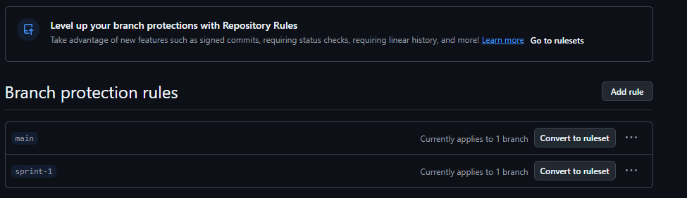

Рисунок 3. Правила защиты main и sprint-1.

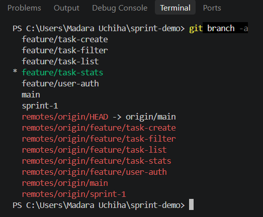

Рисунок 4. Список локальных и удалённых веток — git branch -a.

### Реализация функций

В `src/auth.py` реализованы регистрация, вход и сброс тестового хранилища. Проверяются длина пароля, повторная регистрация, наличие ровно одного символа `@` и непустых частей адреса. Хранилище находится в памяти. В исходном релизе v0.1.0 использовалось учебное хеширование SHA-256 без соли. В hotfix v0.1.1 оно заменено на PBKDF2-HMAC-SHA256 с индивидуальной солью; постоянное хранилище по-прежнему не реализовано.

В `src/tasks.py` реализованы создание задачи и получение копии списка. Название очищается от пробелов по краям, пустое название отклоняется. ID новой задачи вычисляется как максимальный существующий ID плюс один, начальный статус — `completed=False`.

В `src/filters.py` реализована фильтрация по статусу, в `src/stats.py` — подсчёт общего количества, выполненных и невыполненных задач.

| Набор тестов | Количество | Что проверяется |
| --- | --- | --- |
| test_auth.py | 10 | Регистрация, вход, ошибки email и пароля, дубликаты |
| test_task_list.py | 3 | Обычный и пустой список, независимость структуры возвращённого списка |
| test_task_create.py | 7 | Создание, уникальный ID, обрезка пробелов, пустые и пробельные названия |
| test_task_filter.py | 4 | Оба статуса, пустой список, отсутствие совпадений |
| test_task_stats.py | 4 | Смешанный и пустой список, все задачи одного статуса |
| **Итого в исходном спринте** | **28** | Все тесты проходят |

После выполнения заданий D и F добавлено ещё 8 тестов. Итог: **36 passed**, покрытие **52/52 строки (100%)**. Полный журнал: [docs/evidence/final-tests.txt](docs/evidence/final-tests.txt).

Копия в `list_tasks` поверхностная: удаление элемента из результата не меняет исходный список, но вложенные словари остаются общими. Глубокое копирование не входило в критерии текущей функции.

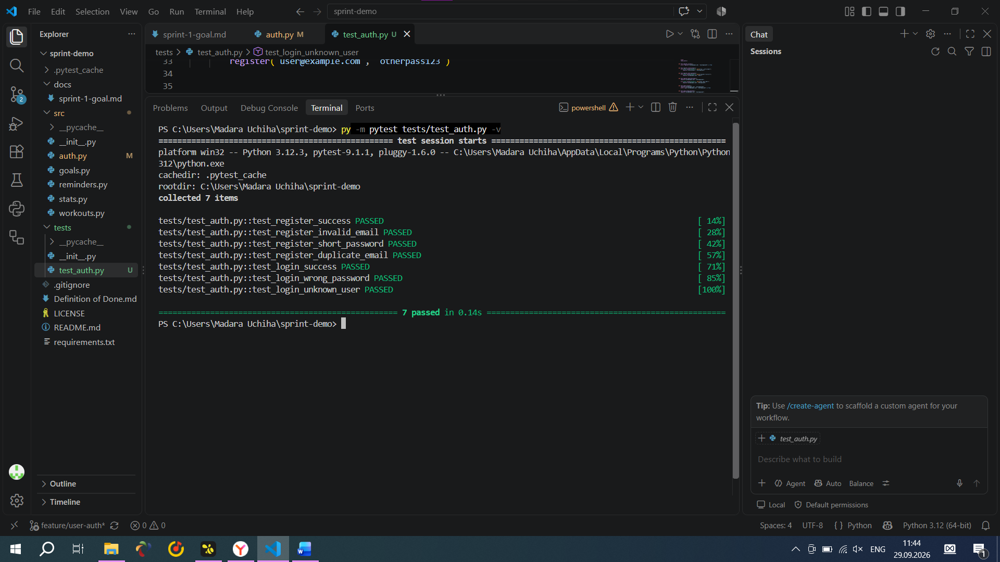

Рисунок 2. Первоначальный запуск семи тестов авторизации до дополнения проверок email.

## 5. Pull Request и самопроверка кода

В PR указаны выполненные изменения, способ проверки, связанные Issues и чек-лист автора. На исходном скриншоте одновременно открыты пять PR с функциями — больше минимально требуемых четырёх.

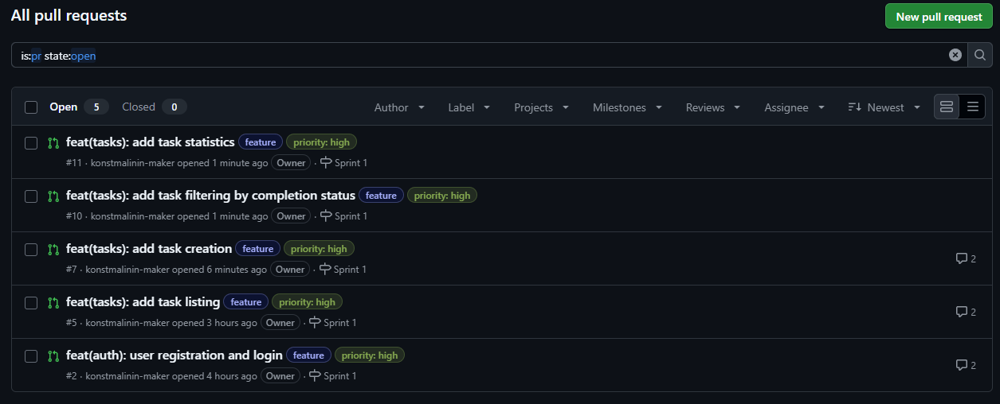

Рисунок 8. Пять открытых PR с функциями менеджера задач.

В трёх обсуждениях зафиксированы конкретные замечания и ответы:

| PR | Замечание | Решение |
| --- | --- | --- |
| [#2](https://github.com/konstmalinin-maker/sprint-demo/pull/2#discussion_r4131747581) | Проверки наличия `@` недостаточно: принимаются адреса с пустыми частями | Добавлена проверка ровно одного `@`, непустых частей и три теста |
| [#5](https://github.com/konstmalinin-maker/sprint-demo/pull/5#discussion_r4131830922) | Проверка другого объекта списка не полностью описывает ожидаемое поведение | Добавлен тест удаления элемента из результата без изменения исходного списка |
| [#7](https://github.com/konstmalinin-maker/sprint-demo/pull/7#discussion_r4133568073) | Не проверены названия из табуляции и перевода строки | Добавлены оба случая; функция выдаёт ValueError и не добавляет задачу |

Все комментарии и ответы оставлены одним аккаунтом `konstmalinin-maker`. Они подтверждают самопроверку, но не требуемое в командном варианте ревью от разных участников.

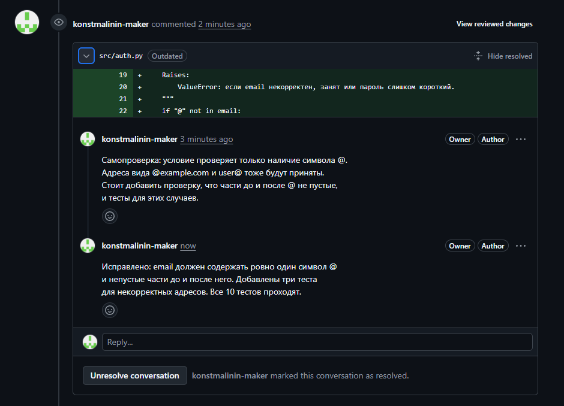

Рисунок 5. Самопроверка валидации email и ответ с исправлением.

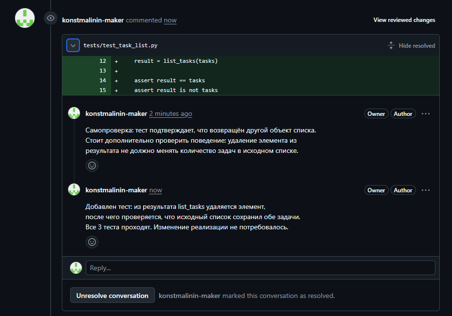

Рисунок 6. Самопроверка поведения копии списка и ответ с дополнительным тестом.

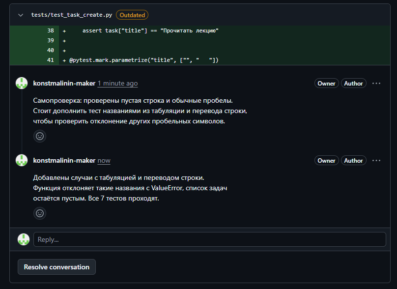

Рисунок 7. Самопроверка пробельных названий и ответ с дополнительными случаями.

## 6. Слияния, конфликт и выпуск

Сначала объединены PR авторизации и просмотра задач. При интеграции создания задач возник конфликт в `src/tasks.py`: обе ветки изменили один общий участок файла. В одной версии находилась функция создания задачи, в другой — функция просмотра.

Для разрешения конфликта выполнены следующие действия:

1. Открыта `feature/task-create` и получено актуальное состояние удалённых веток через `git fetch origin`.
2. Выполнено `git merge origin/sprint-1 --no-edit`.
3. В `src/tasks.py` просмотрены обе версии между маркерами конфликта.
4. Сохранены обе функции — `create_task` и `list_tasks`; маркеры конфликта удалены.
5. Файл добавлен через `git add src/tasks.py`, создан коммит разрешения конфликта и выполнен push feature-ветки.
6. После интеграции функций запущен общий набор тестов: 28 успешных проверок.

Конфликт разрешён сохранением нужного поведения обеих веток, а не выбором одной версии файла целиком.

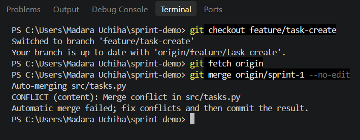

Рисунок 11. Git сообщает о конфликте в src/tasks.py.

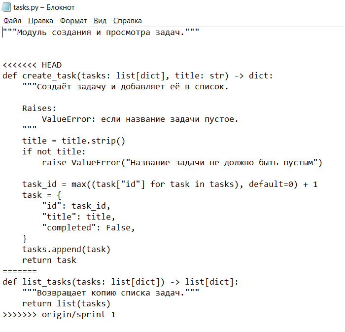

Рисунок 12. Конфликтующие версии функций создания и просмотра задач.

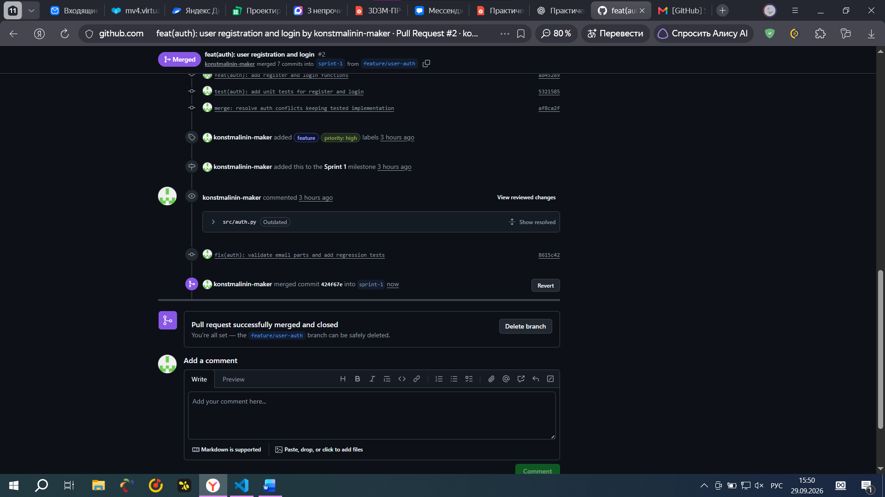

Рисунок 9. PR авторизации объединён с sprint-1.

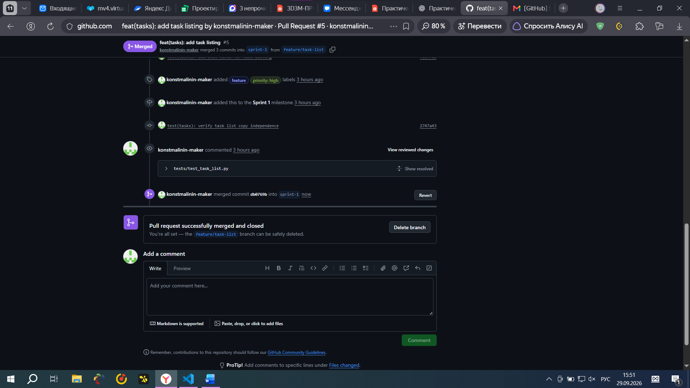

Рисунок 10. PR просмотра задач объединён с sprint-1.

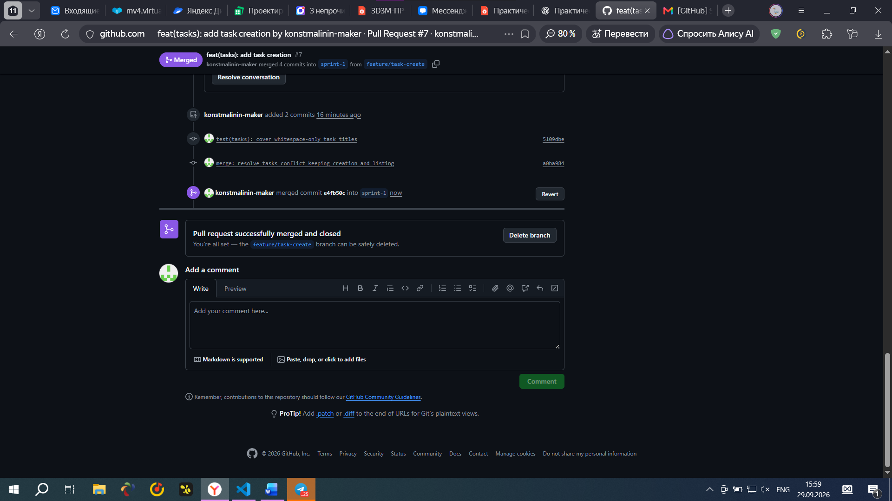

Рисунок 13. PR создания задач объединён после разрешения конфликта.

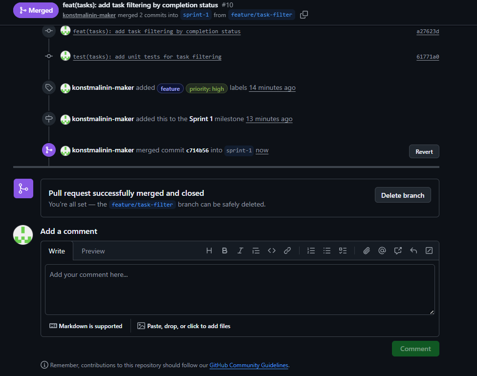

Рисунок 14. PR фильтрации задач объединён с sprint-1.

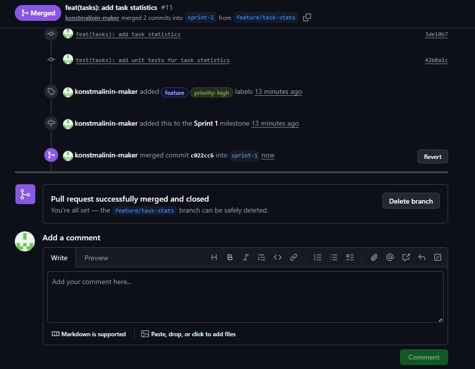

Рисунок 15. PR статистики задач объединён с sprint-1.

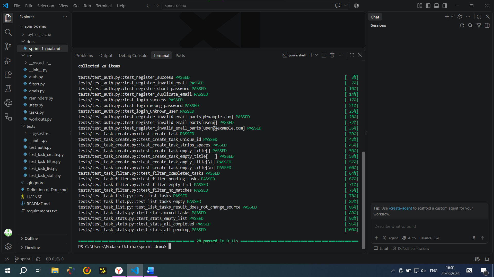

Рисунок 16. Общий запуск: 28 тестов проходят.

После интеграции пяти функций выполнен [финальный PR #12 — sprint-1 → main](https://github.com/konstmalinin-maker/sprint-demo/pull/12). Создан тег и опубликован [релиз v0.1.0](https://github.com/konstmalinin-maker/sprint-demo/releases/tag/v0.1.0). Тег указывает на исходный выпуск MVP (`07ef306`) и при дополнении работы не перемещался.

Протоколы Sprint Review и Retrospective добавлены в основную ветку через [PR #13](https://github.com/konstmalinin-maker/sprint-demo/pull/13). Дополнительные задания интегрированы отдельно через PR #14–#17; их изменения не входят в первоначальный тег v0.1.0.

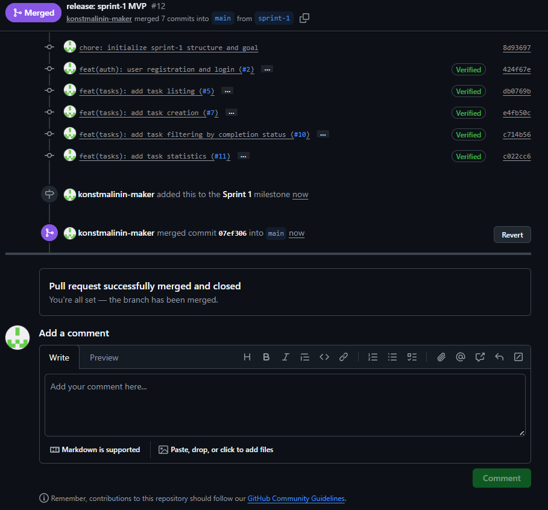

Рисунок 17. Финальное слияние sprint-1 в main через PR #12.

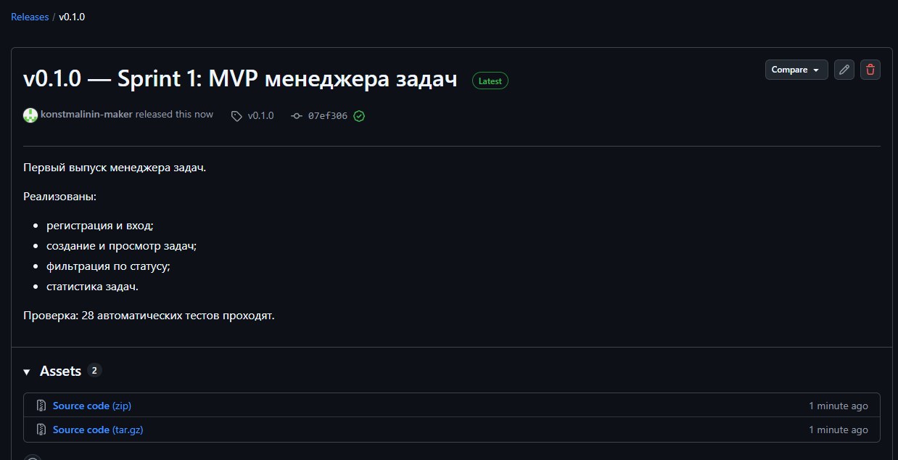

Рисунок 18. Опубликованный релиз v0.1.0.

## 7. Протокол Sprint Review

**Дата основной демонстрации:** 29.09.2026.\
**Исполнитель и принимающий в роли Product Owner:** Малинин Константин Николаевич.\
**Формат:** индивидуальная демонстрация и самостоятельная приёмка.

| Функция | Демонстрация | Наблюдаемый результат | Статус |
| --- | --- | --- | --- |
| Регистрация и вход | Создание пользователя и вход с правильным паролем | Вход возвращает True | Принято самостоятельно |
| Создание задач | Добавление двух задач | Созданы задачи с ID 1 и 2 | Принято самостоятельно |
| Просмотр задач | Получение общего списка | Возвращены обе задачи | Принято самостоятельно |
| Фильтрация | Изменение статуса одной задачи и выбор по статусам | По одной задаче в каждой выборке | Принято самостоятельно |
| Статистика | Подсчёт после изменения статуса | Всего 2, выполнена 1, не выполнена 1 | Принято самостоятельно |

Обратная связь внешнего стейкхолдера или преподавателя в материалах отсутствует. Независимая приёмка не проводилась. По результатам самостоятельной демонстрации цель спринта достигнута: все пять функций реализованы, общий набор тестов проходит.

Протокол: [docs/review-sprint-1.md](https://github.com/konstmalinin-maker/sprint-demo/blob/main/docs/review-sprint-1.md).

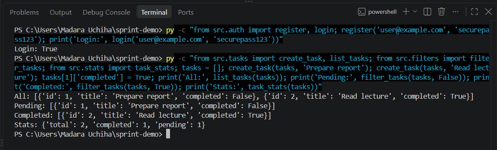

Рисунок 19. Демонстрация входа, создания, просмотра, фильтрации и статистики задач.

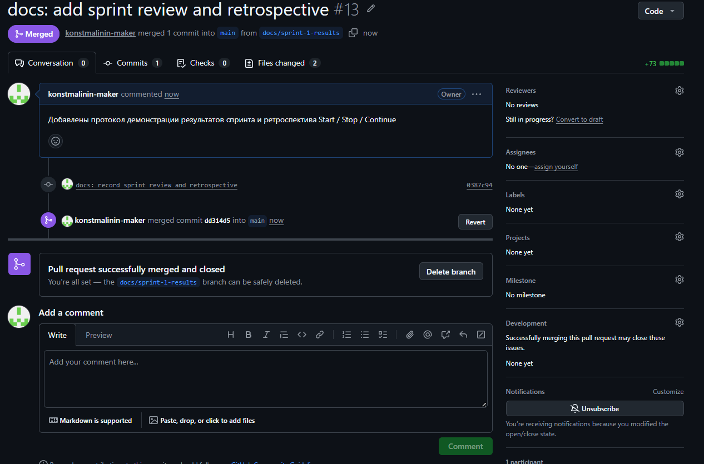

Рисунок 20. PR #13 с протоколами Sprint Review и Retrospective.

## 8. Протокол Retrospective

**Дата:** 29.09.2026.\
**Участник:** Малинин Константин Николаевич.\
**Формат:** Start / Stop / Continue.

**Continue — продолжить:**

- Разрабатывать функции в отдельных feature-ветках.
- Разделять коммиты реализации и тестов.
- Записывать замечания и ответы в PR.
- Запускать весь набор тестов после интеграции.

**Stop — прекратить:**

- Делать коммиты без проверки текущей ветки: первые изменения авторизации попали в `sprint-1` напрямую.
- Считать отдельные успешные проверки функций достаточными без общего запуска после слияния.

**Start — начать:**

- Проверять текущую ветку перед изменением файлов и коммитом.
- Заранее определять функции, которые меняют один файл: создание и просмотр задач затронули `src/tasks.py`.
- Включать граничные случаи в первоначальный набор тестов.
- Использовать обязательную автоматическую проверку PR.

| Действие | Ответственный | Срок / статус |
| --- | --- | --- |
| Выполнять git branch --show-current перед коммитом | Малинин К. Н. | При каждом коммите следующего спринта |
| Определить изменения общих файлов до разработки | Малинин К. Н. | Планирование следующего спринта |
| Добавлять граничные случаи сразу | Малинин К. Н. | Каждая новая функция следующего спринта |
| Подключить Ruff, pytest и отчёт о покрытии в CI | Малинин К. Н. | Выполнено, PR #15 |
| Организовать независимое ревью | Малинин К. Н. | До начала командного спринта; пока не выполнено |

Протокол: [docs/retro-sprint-1.md](https://github.com/konstmalinin-maker/sprint-demo/blob/main/docs/retro-sprint-1.md).

## 9. Дополнительные задания

### Задание A. Интерактивный rebase — выполнено

В `feature/rebase-practice` создано пять коммитов, включая промежуточные `wip`, `fix`, `update`. До объединения история содержала:

```text
1401a71 docs: complete rebase practice notes
7d824f8 update
249aa28 fix
f1a0451 wip
3fe407f docs: start rebase practice notes
```

Выполнен `git rebase -i origin/sprint-1`: первый коммит оставлен, остальные объединены с ним через squash. Итоговое сообщение — `docs: document interactive rebase workflow`, SHA `ca8e653`. Ветка отправлена через `git push --force-with-lease origin feature/rebase-practice`. PR обновился: вместо пяти коммитов остался один. [PR #14](https://github.com/konstmalinin-maker/sprint-demo/pull/14) объединён с `sprint-1`.

Force-push использован для собственной feature-ветки, а не для общей ветки спринта. Скриншоты ниже подтверждают историю до переписывания, успешный rebase, push с проверкой ожидаемого состояния и итоговый PR.

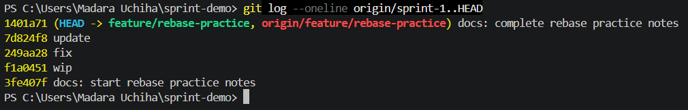

Рисунок 21. Пять коммитов feature-ветки до интерактивного rebase.

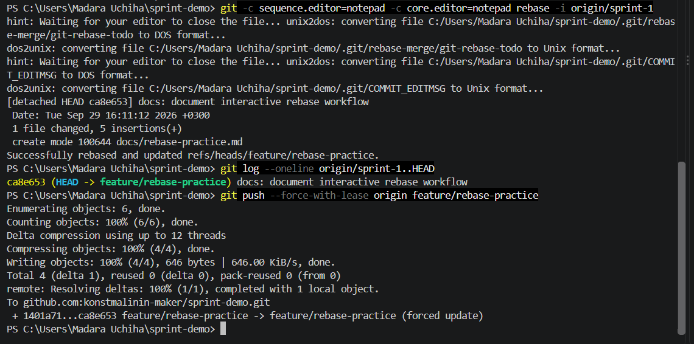

Рисунок 22. Успешный rebase, один итоговый коммит и push --force-with-lease.

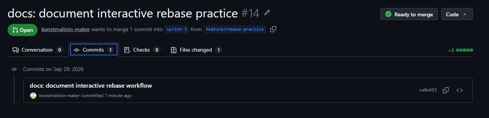

Рисунок 23. PR #14 после rebase содержит один коммит.

### Задание B. GitHub Actions — выполнено

В [.github/workflows/pr-check.yml](https://github.com/konstmalinin-maker/sprint-demo/blob/main/.github/workflows/pr-check.yml) настроены события `pull_request` и `push` для `sprint-1` и `main`. Задание `lint-and-tests` выполняет:

1. Получение кода и настройку Python 3.12.
2. Установку `pytest`, `pytest-cov`, `ruff` из `requirements.txt`.
3. Проверку `python -m ruff check src tests`.
4. Запуск `python -m pytest -v --cov=src --cov-report=term-missing --cov-report=json:coverage.json`.
5. Публикацию комментария о покрытии в PR с помощью `actions/github-script`.

В README добавлен бейдж статуса workflow. [PR #15](https://github.com/konstmalinin-maker/sprint-demo/pull/15) объединён с `sprint-1`.

Для проверки блокировки добавлен намеренно падающий тест (`7843c1f`). [Запуск CI 36574849232](https://github.com/konstmalinin-maker/sprint-demo/actions/runs/36574849232) завершился с `failure`; исходный скриншот показывает заблокированную кнопку слияния. Затем тест удалён (`705d7ae`), и [запуск 36574964235](https://github.com/konstmalinin-maker/sprint-demo/actions/runs/36574964235) завершился успешно. Рабочие ветки не содержат намеренно падающего теста.

Повторная локальная проверка 16.11.2026 на Python 3.12.14 подтвердила: Ruff без замечаний, `28 passed`, покрыто 36 из 36 исполняемых строк — 100%. Это покрытие строк текущего учебного кода; оно не доказывает отсутствие всех возможных ошибок.

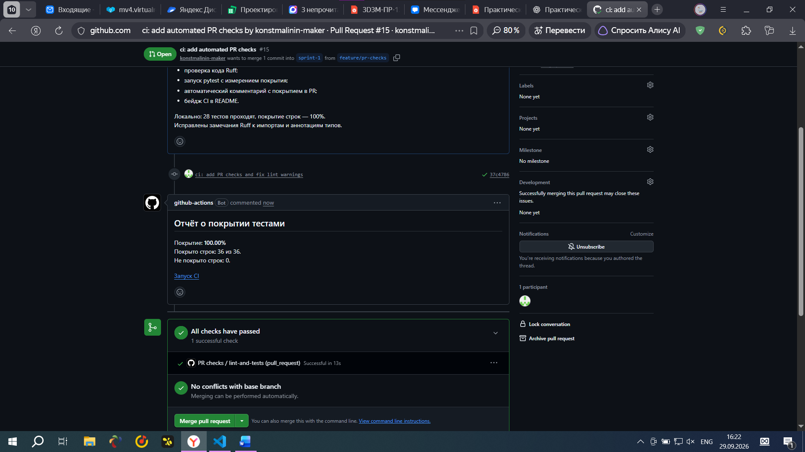

Рисунок 24. Успешный CI и автоматический комментарий о покрытии.

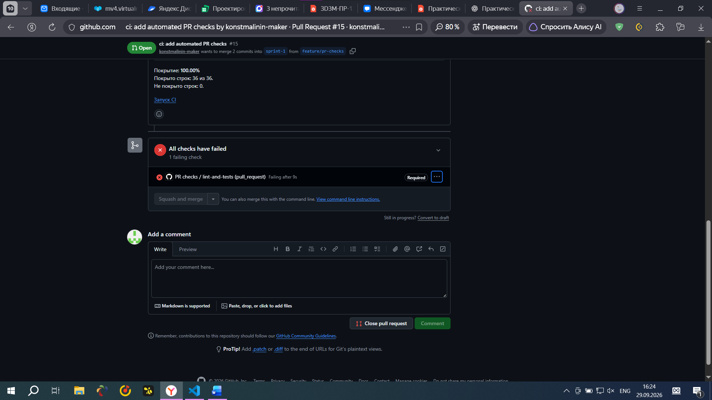

Рисунок 25. Намеренно упавший тест блокирует слияние PR.

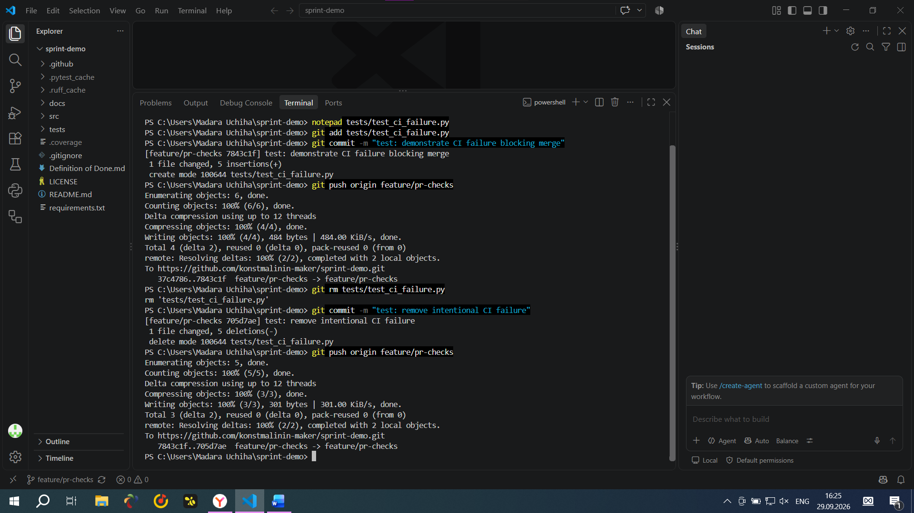

Рисунок 26. Добавление и последующее удаление демонстрационного падающего теста.

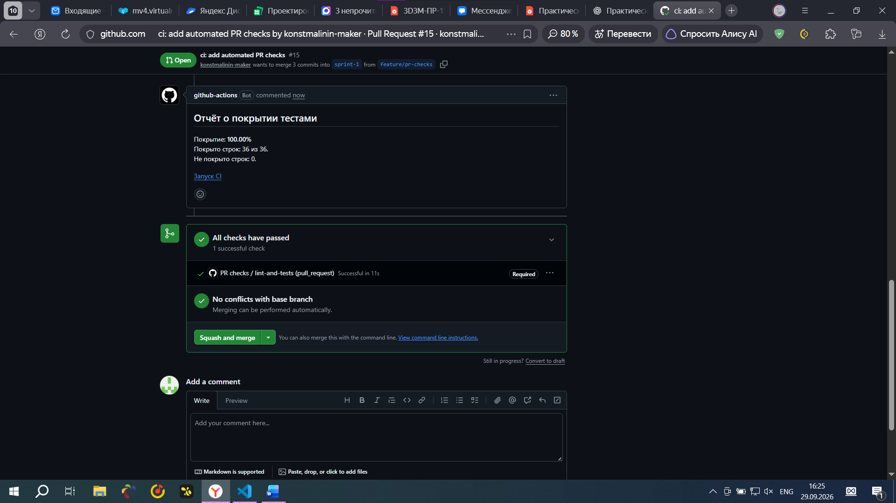

Рисунок 27. Успешная обязательная проверка после удаления падающего теста.

### Задание C. CODEOWNERS — выполнено частично

Создан и объединён [.github/CODEOWNERS](https://github.com/konstmalinin-maker/sprint-demo/blob/main/.github/CODEOWNERS) через [PR #16](https://github.com/konstmalinin-maker/sprint-demo/pull/16). Владельцем реализованных модулей, тестов, Markdown-документов и настроек GitHub назначен `@konstmalinin-maker`.

Перед слиянием GitHub потребовал обязательный статус `lint-and-tests`: старая ветка CODEOWNERS была создана до добавления workflow. Ветка обновлена из `sprint-1`, CI прошёл, после чего PR объединён. Это дополнительно подтвердило действие обязательной проверки.

Сам файл CODEOWNERS не включает обязательное одобрение: требуется отдельная настройка Branch Protection «Require review from Code Owners». Её состояние через доступное подключение не подтверждено. Практическая проверка независимого одобрения владельца кода не выполнена: автор PR и единственный владелец кода — один аккаунт, а GitHub не разрешает автору одобрять собственный PR.

Если обязательное одобрение владельца включено, а единственный подходящий владелец недоступен, PR ожидает его ревью и не соответствует требованиям слияния. Рабочее решение для команды — заранее назначить резервного владельца с правами записи. Отключение защиты ради демонстрации не требуется.

Задание C не засчитывается как полностью выполненное: файл CODEOWNERS добавлен и актуализирован, но обязательное независимое одобрение не проверено. В индивидуальном формате часть, требующая второго участника, пропущена. Подробная настройка защиты также недоступна через подключённый API (HTTP 403). Задания A, B, D, E и F выполнены; ограничения C сохранены явно.

Результаты A, B и файл CODEOWNERS перенесены в `main` через [PR #17](https://github.com/konstmalinin-maker/sprint-demo/pull/17).

### Задание D. Hotfix после выпуска — выполнено

После релиза `v0.1.0` обнаружена слабость авторизации: быстрый SHA-256 без соли даёт одинаковые значения для одинаковых паролей и облегчает массовый подбор. Создана [Issue #19](https://github.com/konstmalinin-maker/sprint-demo/issues/19), затем `hotfix/security-patch` от актуальной `main`.

Регрессионный тест зарегистрировал двух пользователей с одинаковыми паролями и потребовал различные записи в хранилище. До исправления он упал: обе записи совпали. [Журнал до исправления](docs/evidence/hotfix-before.txt) сохранён; он относится к исходному коду, а не к текущему состоянию проекта.

В `src/auth.py` добавлены PBKDF2-HMAC-SHA256 с 600 000 итераций, случайная 16-байтная соль для каждого пользователя и сравнение ключей через `hmac.compare_digest`. Внешние функции `register` и `login` сохранены. Хранилище учебное, в памяти; миграция постоянных записей не требуется.

[PR #22](https://github.com/konstmalinin-maker/sprint-demo/pull/22) открыт в `main` и помечен `priority: high`. После успешного CI он объединён. Проверка hotfix: **29 passed**, покрытие **41/41 строки**, Ruff без замечаний. Затем создан аннотированный тег и опубликован [релиз v0.1.1](https://github.com/konstmalinin-maker/sprint-demo/releases/tag/v0.1.1). Тег закреплён за `57844eb6d2b2ad39c10f26b74b74ba3bdb51b3d7`.

Обратный перенос `main → sprint-1` выполнен обычным merge через [PR #23](https://github.com/konstmalinin-maker/sprint-demo/pull/23). Это сохраняет происхождение исправления и предотвращает его потерю при дальнейшей интеграции спринта. Тег `v0.1.0` не перемещался. Новые функции сценария F появились позже и не входят в `v0.1.1`.

### Задание E. Lead Time и Cycle Time — выполнено

Метрики рассчитаны по фактическим датам GitHub:

- **Lead Time = merged_at связанного PR − created_at Issue**.
- **Cycle Time = merged_at PR − created_at PR**.

Для feature-PR концом цикла считается слияние в `sprint-1`, для hotfix — в `main`. Используется дата слияния, а не дата закрытия Issue: исходные Issues были закрыты позднее при завершении оформления работы. Перерывы и ожидание входят в продолжительность, поэтому эти значения не являются оценкой времени активного программирования.

В [Excel-файле sprint-metrics.xlsx](docs/metrics/sprint-metrics.xlsx) есть листы «Sprint 1», «Все Issues» и «Методика». Длительности и средние рассчитываются формулами, сохранены также проверенные числовые результаты. Две диаграммы редактируются средствами Excel. Исходные даты API хранятся в UTC, в таблицах показано московское время (UTC+03:00).

| Issue | PR | Создана Issue | Открыт PR | Слияние PR | Lead Time, мин | Cycle Time, мин |
| --- | --- | --- | --- | --- | --- | --- |
| #1 | #2 | 29.09.2026 11:45:53 | 29.09.2026 11:48:12 | 29.09.2026 15:50:49 | 244.93 | 242.62 |
| #4 | #5 | 29.09.2026 12:29:33 | 29.09.2026 12:30:20 | 29.09.2026 15:51:31 | 201.97 | 201.18 |
| #6 | #7 | 29.09.2026 15:41:15 | 29.09.2026 15:42:13 | 29.09.2026 15:59:42 | 18.45 | 17.48 |
| #8 | #10 | 29.09.2026 15:45:19 | 29.09.2026 15:46:38 | 29.09.2026 16:00:35 | 15.27 | 13.95 |
| #9 | #11 | 29.09.2026 15:45:31 | 29.09.2026 15:47:21 | 29.09.2026 16:01:06 | 15.58 | 13.75 |

Средний Lead Time: **99.24 мин**. Средний Cycle Time: **97.80 мин**.

Самый долгий цикл у Issue #1 / PR #2: **242.62 мин**. Авторизация открыта первой и объединена во время общей интеграции функций. В её обсуждении подтверждено исправление валидации email и добавление трёх тестов. Timestamps не позволяют разложить весь интервал на активную работу и ожидание; утверждать, что всё это время заняло исправление, нельзя.


Issue #3 дублирует #1 и не имеет самостоятельного PR: значения N/A, из средних исключена. На листе «Все Issues» перечислены все 9 Issues, включая hotfix #19 и обе задачи сценария F (#20 и #21); у 8 из них есть завершённый связанный PR.

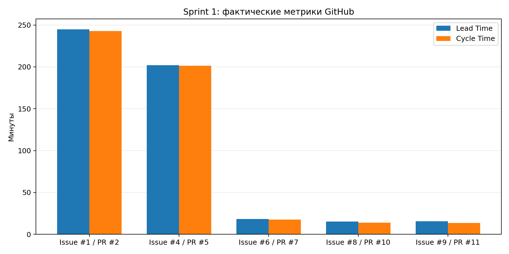

Рисунок 28. Диаграмма фактических метрик исходных пяти функций.

Воспроизведение: установить `requirements-report.txt` и запустить `python scripts/export_sprint_metrics.py`. Для пересчёта по сохранённым JSON без обращения к GitHub добавить `--offline`. Нужны Python 3.12 и авторизованный GitHub CLI для получения новых данных. Снимки API, итоговые числа, методика и диаграммы сохранены в [docs/metrics](https://github.com/konstmalinin-maker/sprint-demo/tree/main/docs/metrics).

### Задание F. Заблокированная задача — выполнено

Созданы две реальные задачи:

- [#20 — предшественник](https://github.com/konstmalinin-maker/sprint-demo/issues/20): функция `complete_task`, отмечающая задачу выполненной.
- [#21 — зависимая задача](https://github.com/konstmalinin-maker/sprint-demo/issues/21): функция `complete_and_summarize`, использующая `complete_task` и возвращающая снимок задачи и статистику.

Issue #21 получила метку `blocked`. Её реализация не начиналась, пока PR предшественника не был объединён. Выбран способ устранения блокировки — **изменение порядка работы**: сначала завершён общий модуль, затем реализована зависимая функция. Один исполнитель последовательно выполняет обе роли; участие второго разработчика не имитируется.

| Событие | Время 16.11.2026, Москва | Подтверждение |
| --- | --- | --- |
| На Issue #21 добавлена метка blocked | 14:14:55 | Событие labeled в истории Issue |
| PR #24 с complete_task объединён | 14:20:16 | merged_at PR #24 |
| С Issue #21 снята метка blocked | 14:20:43 | Событие unlabeled в истории Issue |
| Создан первый коммит зависимой реализации | 14:20:53 | Коммит 74b0887 |
| Зависимая функция отправлена через PR #25 | После реализации и проверок | PR #25, успешный CI и merge |

В `feature/task-complete` добавлена `complete_task`: изменение только нужной задачи, безопасный повторный вызов, KeyError для неизвестного ID. Четыре теста проверяют успех, повтор, неизвестный ID и пустой список. [PR #24](https://github.com/konstmalinin-maker/sprint-demo/pull/24) объединён с `sprint-1`.

После снятия блокировки от обновлённой `sprint-1` создана `feature/completion-summary`. В `src/task_review.py` реализована `complete_and_summarize`, реально импортирующая функцию предшественника. Три интеграционных теста проверяют актуальность статистики, независимость возвращённого снимка от последующих изменений и отсутствие побочных эффектов при неизвестном ID. [PR #25](https://github.com/konstmalinin-maker/sprint-demo/pull/25) объединён с `sprint-1`.

Использовать заглушку можно было бы для предварительной разработки клиента, но она не устранила бы саму зависимость при интеграции. Парное программирование требует второго участника. В выбранном индивидуальном формате эти варианты не применялись.

Подтверждения: [история меток](docs/evidence/blocked-events.json), [даты предшественника](docs/evidence/pr24.json), [даты зависимого PR](docs/evidence/pr25.json), [дата первого коммита](docs/evidence/dependent-first-commit.txt). Итоговая проверка проекта: **36 passed**, покрытие **52/52 строки (100%)**, Ruff без замечаний.

### Итог дополнительных заданий

| Задание | Результат |
| --- | --- |
| A — интерактивный rebase | Выполнено: пять коммитов объединены в один, PR #14 |
| B — GitHub Actions | Выполнено: Ruff, pytest, покрытие, комментарий, бейдж и проверка падения |
| C — CODEOWNERS и обязательное ревью | Файл добавлен и актуализирован. Независимое одобрение пропущено в индивидуальном формате; настройка обязательного одобрения недоступна через API |
| D — hotfix | Выполнено: исправление, регрессионный тест, PR #22, тег и релиз v0.1.1, перенос через PR #23 |
| E — метрики | Выполнено: все Issues учтены, Excel с формулами, средними и двумя диаграммами, вывод и снимки API |
| F — blocked | Выполнено: реальные метки и события, два последовательных PR, зависимая реализация после разблокировки |

## 10. Ответы на контрольные вопросы

**1. Почему feature-ветку создают от sprint-1, а не от main?**

`sprint-1` содержит общую базу текущего спринта и уже интегрированные функции. Новая feature-ветка получает эту базу, а её PR направляется обратно в ветку спринта. `main` сохраняет стабильный выпуск до финальной интеграции.

**2. В чём разница между git merge и git rebase?**

`merge` объединяет истории, сохраняя существующие коммиты; при необходимости создаёт коммит слияния. `rebase` переносит коммиты на другую базу и создаёт для них новые SHA. Переписывание истории общей ветки требует согласования; в работе rebase применялся к собственной feature-ветке.

**3. Что такое Squash and merge и почему он рекомендуется?**

Это объединение всех изменений PR в один новый коммит целевой ветки. Оно убирает промежуточные `wip` и `fix`, упрощает чтение истории и откат отдельной функции. Компромисс — потеря отдельных коммитов feature-ветки в истории целевой ветки. Для финального объединения ветки спринта может быть удобнее обычный merge, сохраняющий её историю.

**4. Что произойдёт, если два PR изменяют одну строку кода?**

После объединения первого PR второй может получить конфликт с новой версией целевой ветки. Git остановит автоматическое слияние, если не сможет совместить изменения. Разработчик должен проверить смысл обеих версий. Если изменения совпадают, Git иногда объединяет их автоматически.

**5. Как разрешить конфликт слияния? Пошагово.**

Получить актуальные ветки (`git fetch origin`), перейти в feature-ветку, выполнить `git merge origin/sprint-1`, посмотреть `git status`, открыть конфликтующие файлы, совместить нужное поведение, удалить маркеры `<<<<<<<`, `=======`, `>>>>>>>`, запустить тесты, выполнить `git add`, создать коммит слияния и отправить ветку. Для конфликта во время rebase после исправления используется `git rebase --continue`.

**6. Зачем нужна Branch Protection и какие правила полезны?**

Она предотвращает попадание непроверенных изменений в общие ветки. Полезны обязательный PR, независимое одобрение, отмена устаревших одобрений после новых коммитов, обязательный успешный CI, актуальность ветки, разрешение обсуждений, запрет force-push и обхода правил. Для этой работы подтверждены защита обеих веток и обязательный CI; полный набор параметров не подтверждён.

**7. Что проверяет код-ревьюер? Что не должен проверять?**

Ревьюер проверяет соответствие задаче, корректность алгоритма, граничные случаи, читаемость, тесты, совместимость и безопасность. Он не должен тратить основное время на форматирование и порядок импортов, если это проверяет линтер, навязывать личный стиль без правила проекта или оценивать личность автора.

**8. Как конструктивно оставить комментарий в PR?**

Указать конкретное место, объяснить наблюдаемую проблему и предложить проверяемое улучшение. Пример: «Проверка наличия `@` пропускает адрес `user@`. Предлагаю проверить непустые части адреса и добавить тест на этот случай». Такой комментарий описывает причину и ожидаемый результат.

**9. Что такое Definition of Done? Приведите пример.**

Это общий набор критериев, по которым работа признаётся завершённой. Пример: функция реализована, тесты проходят, линтер не находит ошибок, выполнено ревью, PR объединён с `sprint-1`, документация актуальна. В индивидуальной работе независимое ревью заменено самопроверкой, что отмечено как ограничение.

**10. Зачем проводить Retrospective? Чем она отличается от Sprint Review?**

Retrospective нужна для улучшения процесса: участники определяют, что продолжать, прекратить и попробовать, назначают ответственных и сроки. Sprint Review посвящён результату продукта: демонстрации функций, обратной связи и достижению цели спринта. Review отвечает на вопрос о полученном результате, ретроспектива — о том, как улучшить следующую работу.

## 11. Трудности и решения

| Трудность | Решение и результат |
| --- | --- |
| Первые коммиты попали в sprint-1 напрямую | Ошибка зафиксирована в ретроспективе; введена проверка текущей ветки перед коммитом |
| Создание и просмотр задач изменили один файл | Конфликт разрешён вручную с сохранением обеих функций; общий набор тестов прошёл |
| Неполная валидация email | Добавлены проверки частей адреса и три граничных случая |
| Недостаточно поведенческих тестов | Добавлены тест копии списка и проверки названий из табуляции и перевода строки |
| Промежуточные wip/fix/update в истории | Пять коммитов объединены интерактивным rebase в один осмысленный |
| Нужно проверить блокировку при ошибке | Создан намеренно падающий тест, зафиксирован неуспешный CI, затем тест удалён |
| CODEOWNERS создан до появления CI | Ветка обновлена из sprint-1; обязательный CI прошёл, PR объединён |
| Один участник вместо команды | Роли объединены, самопроверка явно отделена от независимого ревью |
| Подключение не даёт читать настройки Branch Protection | Зафиксированы подтверждённые факты: protected=true и блокировка обязательным статусом; остальные параметры не объявлены выполненными |

## 12. Результат и ограничения

В исходном спринте реализованы пять функций менеджера задач и 28 тестов. После дополнения hotfix и сценария F в проекте **36 автоматических тестов**. Пять feature-PR объединены с `sprint-1`, конфликт в `src/tasks.py` разрешён, спринт перенесён в `main`, опубликован релиз `v0.1.0`. Оформлены Sprint Review и Retrospective. Выполнены дополнительные задания A, B, D, E и F; добавлен и актуализирован файл CODEOWNERS (C). Выпущен hotfix v0.1.1. При итоговой проверке Ruff не выявил замечаний, все 36 тестов прошли, покрытие строк составило 100% (52 из 52).

Остаются ограничения индивидуального формата: нет команды из 4–5 человек, независимых ревью разных участников и внешней приёмки. Обязательное одобрение Code Owner не подтверждено, поэтому задание C описано как частичное. Эти пункты требуют участия других людей и проверки настроек владельцем репозитория; они не представлены как выполненные.

Все 27 исходных скриншотов сохранены из первоначального DOCX и отражают этапы работы 29.09.2026. Дополнительно построена диаграмма метрик (рисунок 28). Результаты дополнения 16.11.2026 подтверждаются ссылками на PR, релиз, запуски GitHub Actions и сохранённые данные API.
