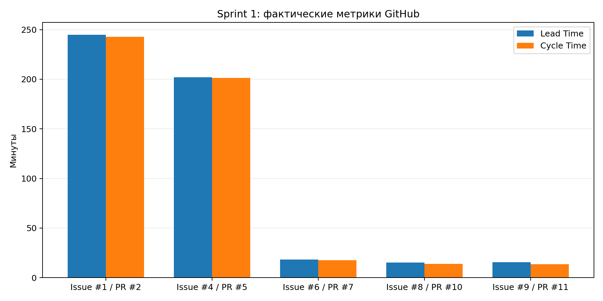

# Метрики Sprint 1

Источник — timestamps Issues и PR GitHub; время в таблице московское (UTC+03:00).

| Issue | PR | Создана Issue | Открыт PR | Слияние PR | Lead Time, мин | Cycle Time, мин |
| --- | --- | --- | --- | --- | --- | --- |
| #1 | #2 | 29.09.2026 11:45:53 | 29.09.2026 11:48:12 | 29.09.2026 15:50:49 | 244.93 | 242.62 |
| #4 | #5 | 29.09.2026 12:29:33 | 29.09.2026 12:30:20 | 29.09.2026 15:51:31 | 201.97 | 201.18 |
| #6 | #7 | 29.09.2026 15:41:15 | 29.09.2026 15:42:13 | 29.09.2026 15:59:42 | 18.45 | 17.48 |
| #8 | #10 | 29.09.2026 15:45:19 | 29.09.2026 15:46:38 | 29.09.2026 16:00:35 | 15.27 | 13.95 |
| #9 | #11 | 29.09.2026 15:45:31 | 29.09.2026 15:47:21 | 29.09.2026 16:01:06 | 15.58 | 13.75 |

Средний Lead Time: **99.24 мин**. Средний Cycle Time: **97.80 мин**.

Самый долгий цикл у Issue #1 / PR #2: **242.62 мин**. Авторизация открыта первой и объединена во время общей интеграции функций. В её обсуждении подтверждено исправление валидации email и добавление трёх тестов. Тimestamps не позволяют разложить весь интервал на активную работу и ожидание; утверждать, что всё это время заняло исправление, нельзя.

Issue #3 — дубликат #1 без самостоятельного PR. Значения N/A, в среднее не включена. Все остальные Issues и дополнительные задачи приведены на листе «Все Issues».

[Excel с формулами и редактируемыми диаграммами](sprint-metrics.xlsx).

